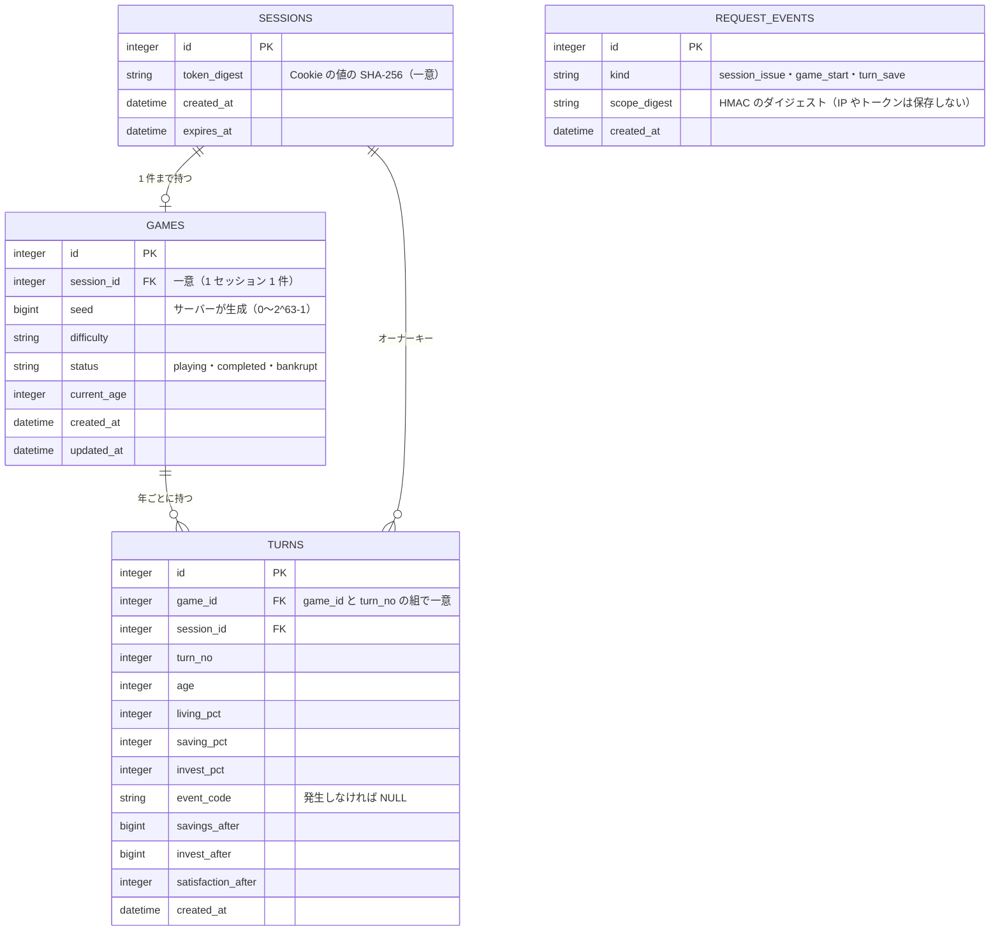
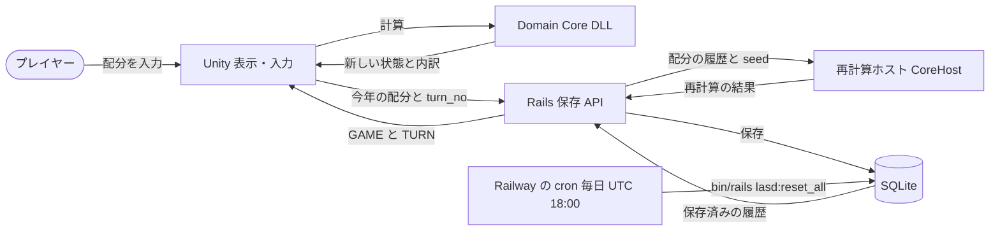
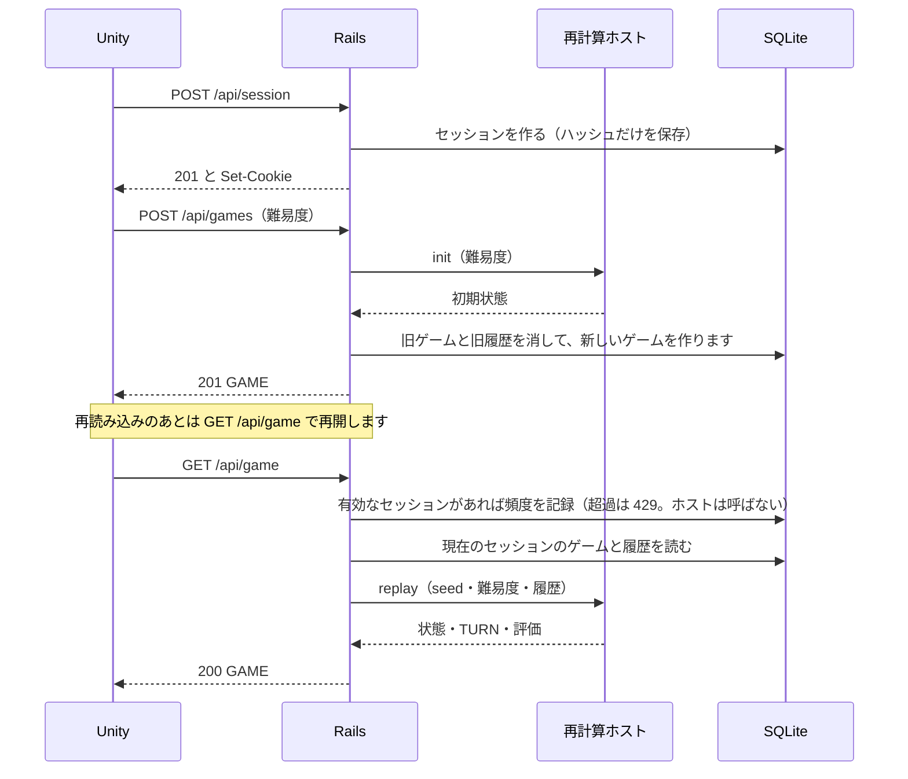
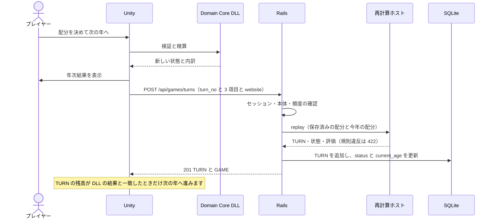
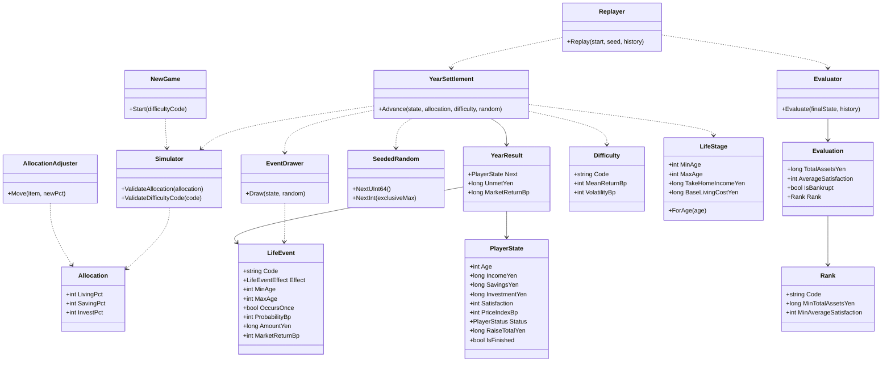
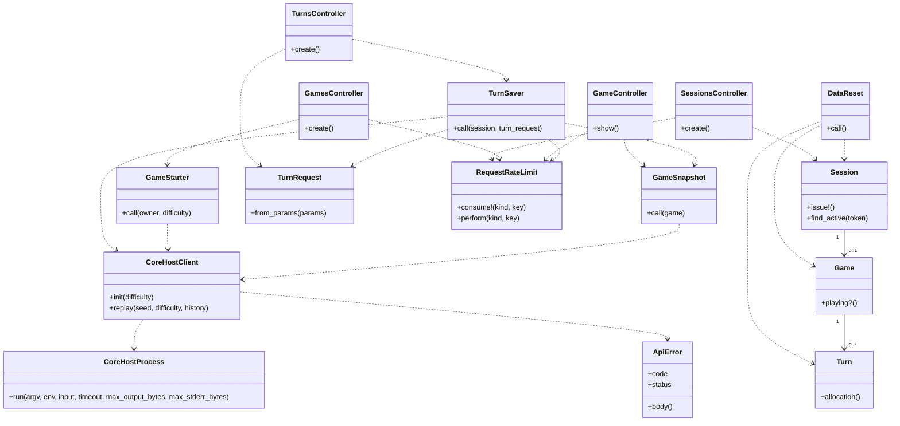
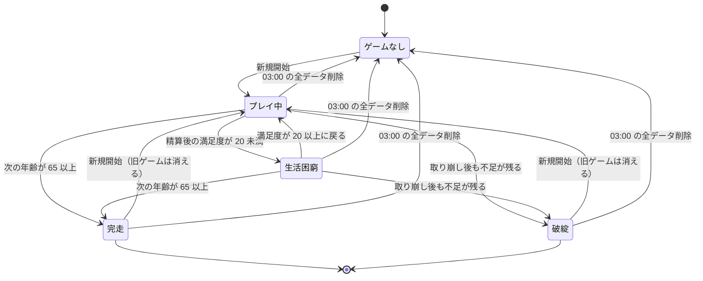
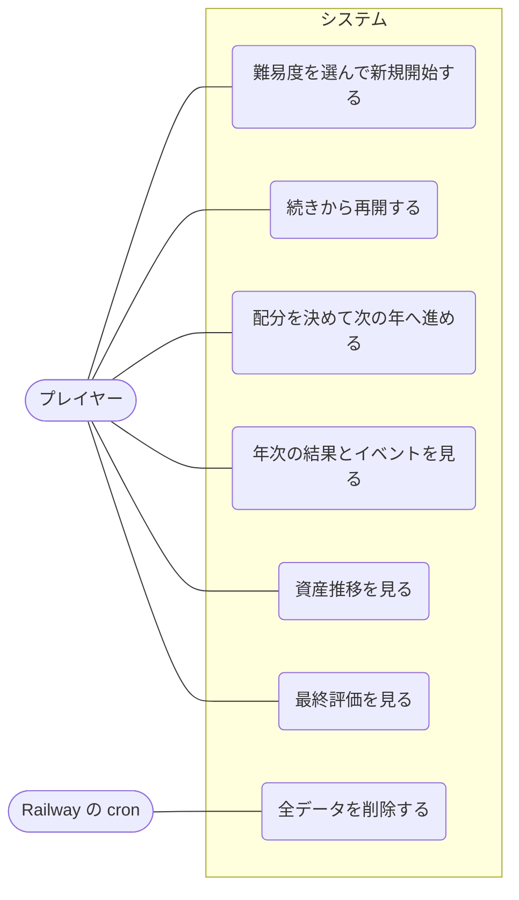

# 図（実装に合わせた版）

設計書（`requirements.md` の 7〜12 章）の図を、実装のコードと照らして書き直したものです。違いは [設計書との差](design-differences.md) に書きます。図は Mermaid で書いています（GitHub で表示されます）。

## ER 図

テーブルは `src/backend/db/schema.rb` が正です。マスタ（ライフステージ・イベント・難易度・ランク）は Domain Core の定数で、DB には置きません。

## DFD（データの流れ）

- 図の「配分の履歴と seed」は、サーバーの中（Rails から再計算ホストへ）の受け渡しです。ブラウザからは seed を送りません。
- 画面が受け取るのは、サーバーで再計算した値だけです。
- Railway の cron は、デプロイ時に設定する手順です（未確認）。図の cron は、その手順の流れを示します。

## シーケンス図（開始と再開）

## シーケンス図（1 年の保存）

- 同じ番号・同じ配分の再送は、保存せず 200 で保存済みの結果を返します（ゲームが終了していないとき）。
- 配分の規則は、ホストが検査します。Rails は規則を持ちません。

## クラス図（Domain Core）

## クラス図（保存 API）

## 状態遷移図（ゲームの状態）

状態は `games.status` と、再計算ホストの `state.status`・`state.struggling` で決まります。「生活困窮」は `status` が `playing` のまま、`struggling` が `true` の状態です。

- 完走と破綻のあとは、新しい番号の保存も、保存済みの番号の再送も、409（`game_finished`）で断ります。
- 03:00 の全データ削除では、セッションも消えます。その後の要求は、セッションが無いものとして扱われます。

## ユースケース図

