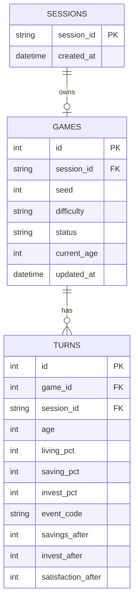
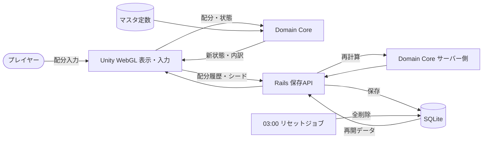
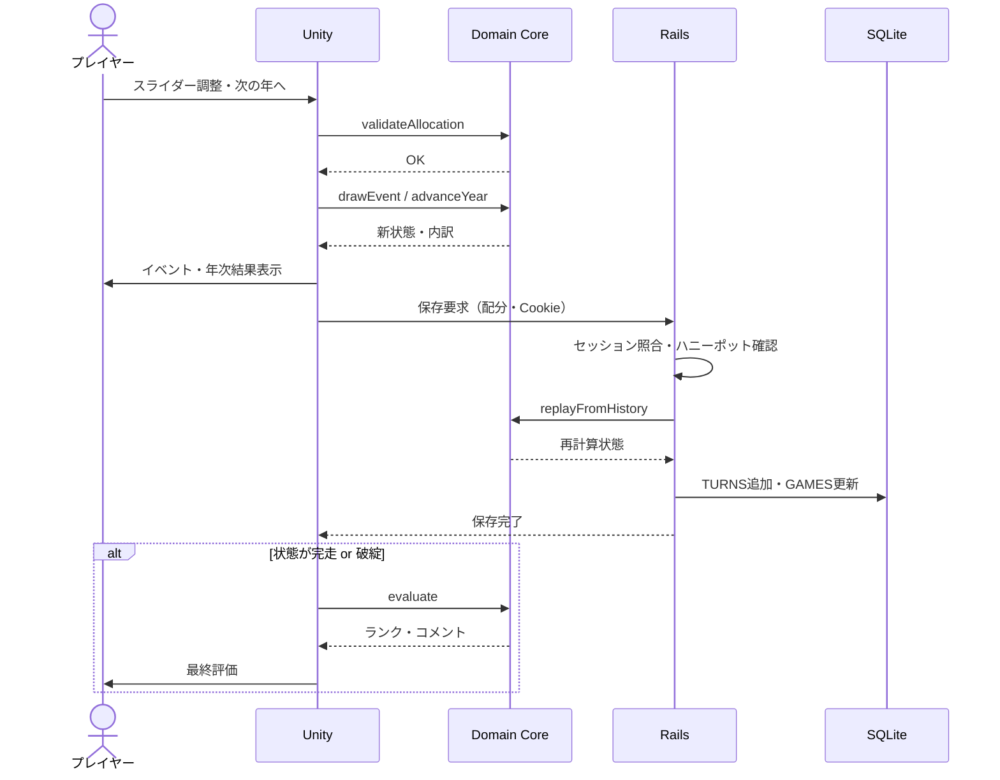
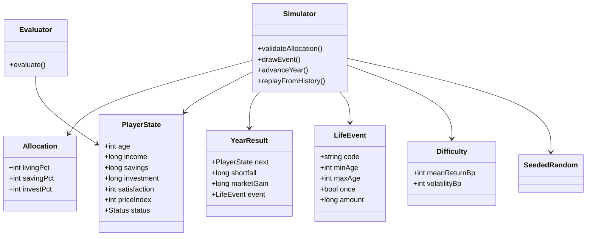
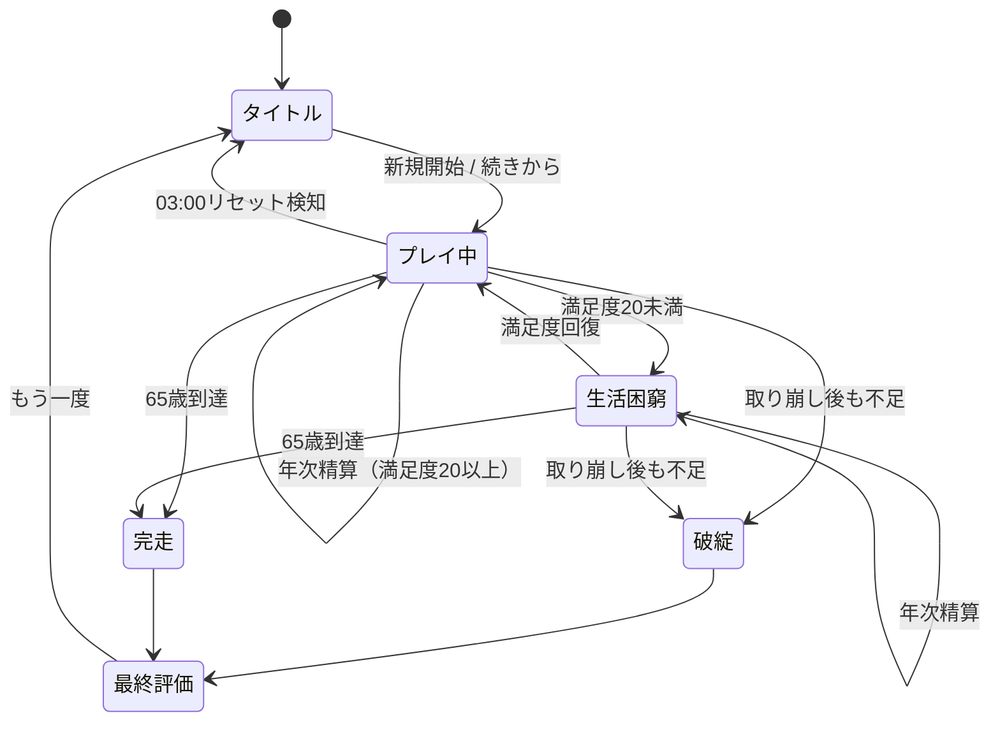
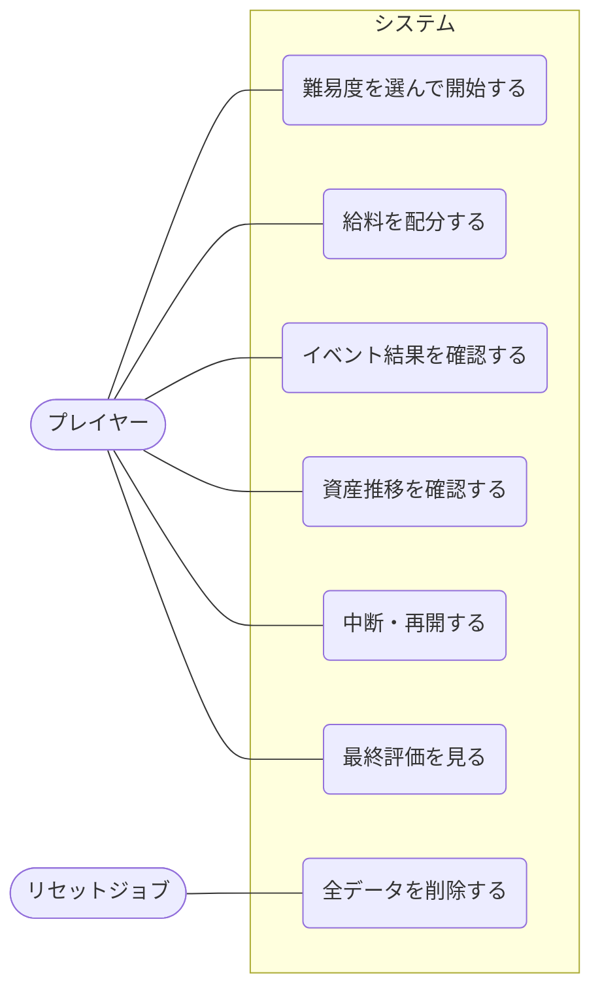

# life-allocation-sim-demo 仕様書（デモ版）

給料を「生活費・貯蓄・投資」に配分し、22歳から65歳までの資産推移を体験する人生設計シミュレーション。

---

## 1. 概要

| 項目 | 内容 |
|---|---|
| リポジトリ名 | `life-allocation-sim-demo` |
| エディション | デモ版（アイデアの視覚化） |
| プラットフォーム | ウェブ（シミュレーション区分：Unity WebGL） |
| 目的 | 配分比率の違いが数十年後の資産・生活の安定にどう効くかを、短時間のプレイで体感させる |
| デザイン / 測定 / 保守 / 監視 | なし / なし / なし / なし |

### 1.1 プラットフォーム選定理由

- 成果物を直接操作するのは人間であり、ターゲットは人間向けとなる。
- 毎ターンのプレイヤー入力（配分比率）に応じて結果が変わるため、電子書籍・動画は選択できない。
- 課題は「お金の配分という意思決定の練習」であり、シミュレーション（意思決定の練習）に該当するため、ゲーム節ではなくウェブ節のシミュレーション規定に従い、Unity WebGLで実装する。

### 1.2 教育目的の範囲

- 本作の利回り・イベント・物価はすべて架空のモデル値であり、実在の金融商品・個別の投資判断を示すものではない。画面上にもその旨を常時表示する。

---

## 2. 技術構成

| 層 | 技術 | 配置 |
|---|---|---|
| Domain Core | Unity非依存の純粋C#ライブラリ（計算・判定のみ） | `src/core/` |
| 表示・入力 | Unity WebGL（シーン・UI・オブジェクトはすべてコードで動的生成） | `src/unity/` → ビルド成果物をVercelへ |
| 保存API | Rails（API mode） | `src/backend/` → Railway（不可時Render） |
| DB | SQLite（デモ版規定によりデプロイ先を問わずSQLite） | Railwayボリューム |

- Unityは表示と入力のみを担い、Domain Coreを呼び出すだけとする。
- ビルドは `Unity.exe -batchmode -nographics -executeMethod` によるCLI実行とする。
- PlayerPrefs・Unity Playは使用しない。ページロード時のDBリセット処理も行わない。
- 外部API・APIキー・reCAPTCHAは使用しない。Bot対策はハニーポット項目（不可視の入力欄に値が入った保存要求を破棄）で行う。
- 実装は1issueのワンショットで行う。

### 2.1 認証・セッション・リセット

- ユーザー認証なし。初回アクセス時にRailsがランダムなセッションID（推測不能な長さ）をHttpOnly Cookieで発行する。
- 全テーブルにセッションIDをオーナーキーとして持たせ、全クエリでセッションIDによる絞り込みを必須とする。他セッションのデータは参照・更新とも不可。
- JST 03:00に全データを自動削除する（Railwayのcronジョブ）。
- 個人情報（氏名・生年月日・メール・住所・電話）は一切入力させない。年齢はゲーム内の架空年齢のみ。

---

## 3. ゲームルール

### 3.1 進行

- 1ターン＝1年。開始22歳、終了65歳（全43ターン）。
- 各ターンでプレイヤーは手取り年収を「生活費・貯蓄・投資」の3つに配分する（スライダー3本、5%刻み）。
- 前ターンの配分を初期値として引き継ぎ、変更せずに「次の年へ」を押せる。

### 3.2 マスタデータ

| 区分 | 件数 |
|---|---|
| ライフステージ（収入・必要生活費のテーブル） | 5段階（22–29 / 30–39 / 40–49 / 50–59 / 60–65） |
| ライフイベント | 12種（出費系8・収入系2・市場系2） |
| 難易度（市場の振れ幅） | 3段階 |
| 評価ランク | 5段階 |

### 3.3 プレイヤーの状態

| 項目 | 説明 |
|---|---|
| 年齢 | 22〜65 |
| 手取り年収 | ライフステージ表から決定。昇給イベントで加算 |
| 必要生活費 | ライフステージ表×物価係数 |
| 貯蓄残高 | 元本保証、固定の低金利 |
| 投資評価額 | 毎年の市場リターンで増減 |
| 生活満足度 | 0〜100。生活費の充足度で増減 |
| 状態 | プレイ中 / 生活困窮 / 破綻 / 完走 |

---

## 4. 関数仕様（Domain Core）

ロジックは自然言語で定義する。すべて副作用を持たない純粋関数とし、乱数は引数で渡すシード付き乱数のみを用いる（同一シード・同一入力なら同一結果）。

### 4.1 `validateAllocation(配分)`

1. 3項目がいずれも0以上100以下の整数で、5の倍数であることを確認する。
2. 合計がちょうど100であることを確認する。
3. 満たさない場合は「不正」と理由（負値／刻み違反／合計不一致）を返し、ターンを進めない。
4. UI側では、1本のスライダーを動かすと残り2本が比率を保って自動調整され、常に合計100になる。調整で端数が出た場合は最後に動かしていない項目で吸収する。

### 4.2 `drawEvent(状態, 乱数)`

1. その年齢で発生可能なイベントだけを候補にする（例：結婚・出産は25〜45歳、家電故障は全年齢、介護は50歳以上）。
2. 一度きりのイベント（結婚等）は発生済みなら候補から外す。
3. 候補ごとの発生確率で抽選し、0件または1件を返す（1年に複数イベントは起こさない）。
4. 22歳の初年度はイベントを発生させない（操作に慣れる期間）。

### 4.3 `advanceYear(状態, 配分, 難易度, 乱数)` — 1年の精算

順序を固定して処理する。

1. **配分**：手取り年収を配分比率で生活費枠・貯蓄枠・投資枠に分ける（円未満は切り捨て、端数は貯蓄枠へ）。
2. **生活費判定**：生活費枠と必要生活費を比較する。
   - 生活費枠 ≥ 必要生活費：余剰は貯蓄に入れ、満足度を上げる（ただし必要額の1.5倍を超える部分は満足度に効かない）。
   - 生活費枠 < 必要生活費：不足額を「取り崩し処理」に回し、満足度を下げる。
3. **積立**：貯蓄枠を貯蓄残高に、投資枠を投資評価額に加える。
4. **イベント**：`drawEvent` の結果を適用する。出費は貯蓄から支払い、不足分は取り崩し処理に回す。
5. **運用**：貯蓄に固定金利を付ける。投資評価額に、難易度ごとの平均と振れ幅から決まる年間リターンを掛ける。暴落イベントの年はリターンを大きなマイナスに置き換える。
6. **取り崩し処理**：不足額を ①貯蓄 → ②投資（その年の評価額で売却）の順に充当する。
7. **物価**：物価係数を毎年わずかに上げる（必要生活費が長期で増えることを体感させる）。
8. **状態判定**：
   - 取り崩し後も不足が残る → 「破綻」で即終了。
   - 満足度が20未満 → 「生活困窮」（警告表示。翌年以降に回復可能）。
   - 年齢が65に達した → 「完走」。
9. 新しい状態と、その年の内訳（収入・各枠・イベント・運用損益・取り崩し額）を返す。

### 4.4 `evaluate(最終状態, 履歴)`

1. 総資産（貯蓄＋投資評価額）、平均満足度、破綻の有無、困窮年数を算出する。
2. 次の3観点で評価コメントを組み立てる（ルールベース、定型文の組み合わせ）。
   - 老後資金：総資産を目安額と比較。
   - 生活の質：平均満足度。
   - 備え：取り崩しが投資の売却まで及んだ年数。
3. 5段階ランクを決定する。破綻した場合は資産額によらず最下位とする。
4. 「生活費を削りすぎて満足度が低い高資産」は最上位にしない（貯めることだけが正解ではないことを伝える）。

### 4.5 `replayFromHistory(初期状態, 配分履歴, シード)`

- 保存された配分履歴とシードから、`advanceYear` を順に適用して状態を再構築する。保存データの改ざん検知と再開処理に用いる。

---

## 5. 設計原則・境界条件

- 配分合計は常に100%であり、不正な配分でターンが進むことはない。
- 0%配分（例：投資0%、貯蓄0%）は正当な選択として受け付ける。生活費0%は受け付けるが、その年は必ず不足が発生する。
- 投資評価額は0未満にならない（下限0）。
- 金額はすべて整数（円）で計算し、浮動小数点の誤差を持ち込まない。リターン率は万分率の整数で保持する。
- 破綻判定は取り崩し処理の後に行う。貯蓄が0でも投資で賄えれば破綻しない。
- イベント出費が年収を上回る年でも、計算順序は固定であり結果は一意に決まる。
- 同一シード・同一配分履歴からは常に同一の結果が得られる（再現性）。
- ページ再読込・ブラウザ終了後は、最後に保存したターンから再開できる。保存はターン精算ごとに自動で行う。
- サーバー側は保存時に `replayFromHistory` で再計算し、クライアント送信の状態値は信用しない。
- 03:00のリセットをまたいでプレイ中だった場合は、次回保存時に「データがリセットされた」旨を表示し、新規ゲームを開始させる。
- 1セッションが同時に持てるゲームは1件。新規開始時は既存ゲームを上書きする（確認ダイアログあり）。
- 保存APIはリクエストサイズ上限とセッション単位の頻度制限を持つ。

---

## 6. 画面構成

| 画面 | 内容 |
|---|---|
| タイトル | 難易度選択・新規開始・続きから |
| メイン | 年齢・状態表示、配分スライダー3本、資産推移グラフ（貯蓄・投資の積み上げ）、満足度メーター、「次の年へ」 |
| イベント表示 | 発生イベントと金額影響のカード |
| 年次結果 | その年の内訳 |
| 最終評価 | ランク・3観点のコメント・全期間グラフ・もう一度遊ぶ |

- 色だけで意味を区別しない（貯蓄・投資はグラフ上で模様とラベルでも区別する）。

---

## 7. ER図

マスタ（ライフステージ・イベント・難易度・ランク）はDomain Core内の定数として持ち、DBには置かない。

---

## 8. DFD

---

## 9. シーケンス図（1ターン）

---

## 10. クラス図

---

## 11. 状態遷移図

---

## 12. ユースケース図

